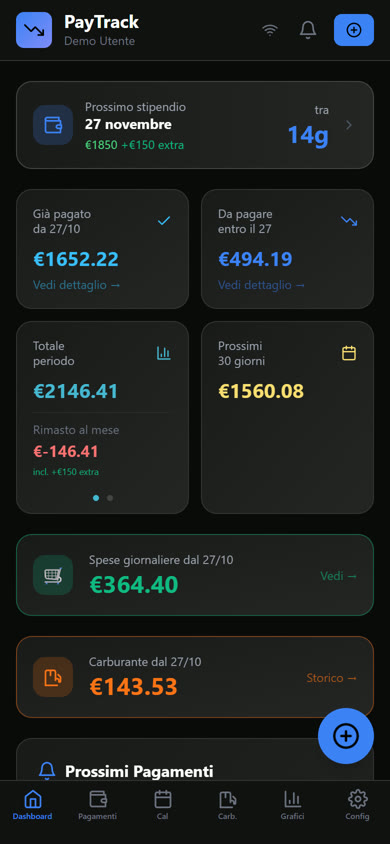
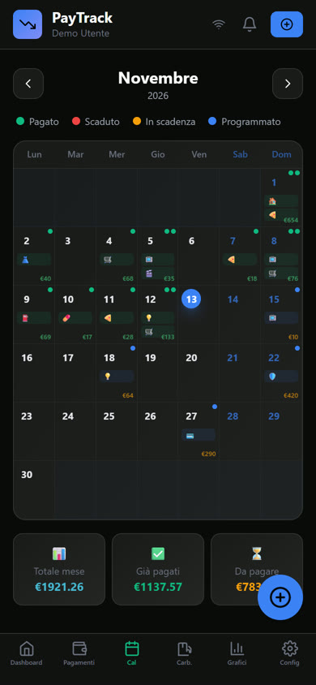
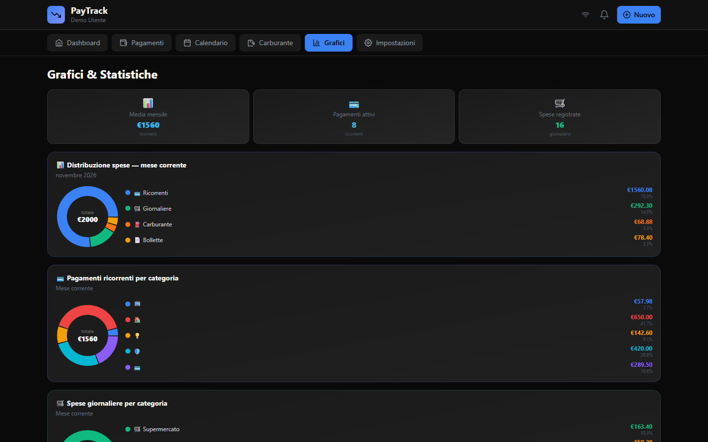
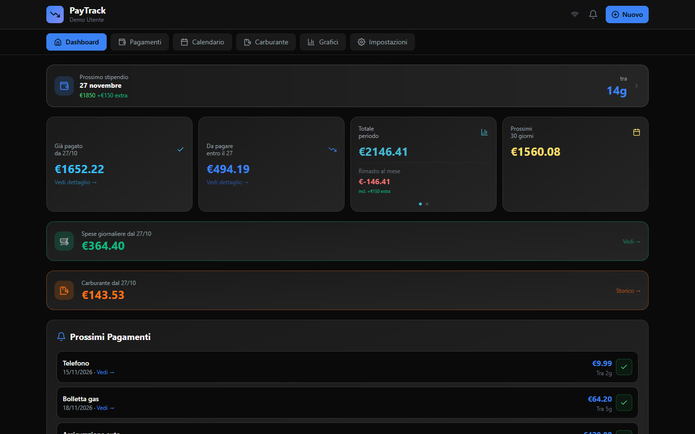

# PayTrack

App per tenere sotto controllo le finanze personali: pagamenti ricorrenti, spese di tutti i giorni, carburante, bollette ed entrate extra, con scadenze, calendario e grafici. **Legge da sola i movimenti bancari** dalle notifiche dell'app della banca, senza collegarsi al conto.

**Progettata e sviluppata interamente da me**: web app, API, database e app Android. Versione 1.8.16.

> Il codice è in un repository privato: posso mostrarlo durante un colloquio.

**Stack:** React 18 · Tailwind CSS · Recharts · PWA (service worker, offline) · PHP 8 (API REST, JWT) · MySQL · Android con Capacitor 5 + codice nativo Java · Web Push (VAPID)

  
  
  

Screenshot da un'installazione locale con dati di prova.

## Cosa fa
- **Ricorrenti:** abbonamenti, rate, utenze, affitto, assicurazioni, con promemoria prima della scadenza.
- **Spese giornaliere** per categoria (supermercato, farmacia…), **carburante** e **bollette**.
- **Entrate extra** e **stipendio**, con "quanto resta" nel mese al netto dei pagamenti previsti.
- **Dashboard, calendario e grafici** per periodo e per categoria.
- **Modalità privacy** che nasconde lo stipendio e i valori da cui si potrebbe ricavare.
- **Accesso con impronta** (biometria Android).

## Import automatico dalla banca
Su Android l'app legge le notifiche dell'app bancaria (`NotificationListenerService` nativo) e propone il movimento già compilato: importo, esercente, categoria.
- Funziona anche ad app chiusa: le transazioni restano in coda e vengono importate alla riapertura.
- **Deduplicazione su 3 livelli**, per non registrare due volte lo stesso movimento quando la banca manda notifiche ripetute.
- Procedura guidata per i permessi di risparmio batteria dei produttori (Samsung, Xiaomi, OPPO, OnePlus, Huawei, Vivo), che altrimenti bloccano il servizio in background.

## Architettura
- **Web app React** installabile come PWA, con cache locale e funzionamento offline; i dati si sincronizzano quando torna la rete.
- **API PHP** con autenticazione JWT, password con bcrypt, endpoint separati per pagamenti, carburante, bollette, entrate e impostazioni.
- **App Android** che incapsula la web app e aggiunge le funzioni native via `JavascriptInterface`: notifiche bancarie, biometria, notifiche locali programmate, impostazioni del produttore.
- Changelog dettagliato per ogni versione, con file toccati e motivazioni.

---
**Filippo Bonanno** · sviluppatore web e mobile · [altri progetti](https://github.com/FilippoBonanno)
